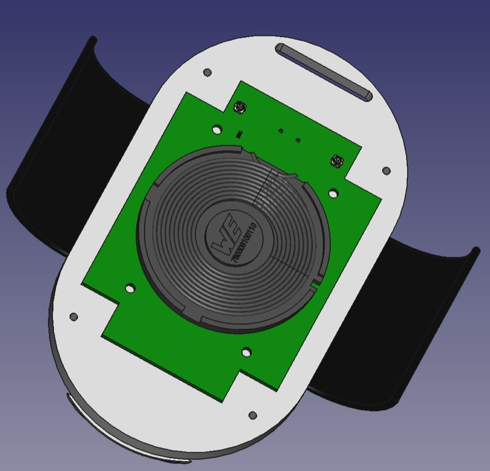

# Charger

**Repo:** [CARSSCenter/OpenNerve-Charger](https://github.com/CARSSCenter/OpenNerve-Charger)
**Applies to revision:** not yet assigned
**Last reviewed:** not yet reviewed

!!! danger "Not approved for human use"
    Nothing described on this page has regulatory clearance for human use.
    See [Regulatory status and disclaimers](../regulatory/status.md).

*CAD model of charger, showing inductive charging coil and PCBA.*

## About

A wireless charger that inductively charges the OpenNerve IPG.
Firmware runs a state machine (`INITIALIZATION` → `WAIT` → `SCAN` →
`SLOW_CHARGE_AND_SCAN`/`CHARGE`) with front-panel buttons for scan, MCU reset,
and DFU (USB-C firmware update) mode, and LED indicators for charge state.
Charging includes thermal protection: it stops automatically if the IPG
reports a temperature at or above 41 °C.
([source](https://github.com/CARSSCenter/OpenNerve-Charger/blob/main/README.md))

## Firmware details and documentation

- [Firmware report](charger/firmware-report.md)

## Maturity

Evidence
E1
Bench tested

Manufacturing readiness
M2
Manufacturable using PCBA suppliers and 3D printing

See [Maturity level definitions](../regulatory/maturity.md).

