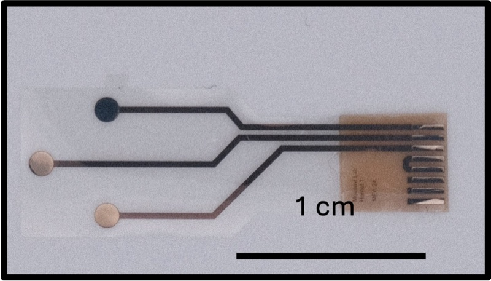

# Chemical Sensors

**Repo:** [CARSSCenter/Chemical-Sensors](https://github.com/CARSSCenter/Chemical-Sensors)

!!! danger "Not approved for human use"
    Nothing described on this page has regulatory clearance for human use.
    See [Regulatory status and disclaimers](../regulatory/status.md).

## About Chemical Sensors

Chemical sensing leads for OpenNerve. Two sensors are described in the repo:

- A **square wave voltammetry** sensor for detection and differentiation of
  catecholamines such as dopamine and serotonin.
- An **amperometric** sensor for measuring concentrations of acetylcholine
  and pH.

([source](https://github.com/CARSSCenter/Chemical-Sensors/blob/main/README.md))

*A prototype chemical sensor platform microfabricated on a Parylene C substrate.*

## Documentation synced from the upstream repo

The pages below are pulled from the Chemical-Sensors repo by
`tools/sync_docs.py` — each carries a banner recording the exact upstream
commit it reflects. Edit them upstream, not here.

- [Characterization of echem sensors](chemical-sensors/characterization.md)
- [Fabrication of echem sensors](chemical-sensors/fabrication.md)

## Maturity

Evidence
E2
Acute in vivo

Manufacturing readiness
M1
Lab reproducible

See [Maturity level definitions](../regulatory/maturity.md).
