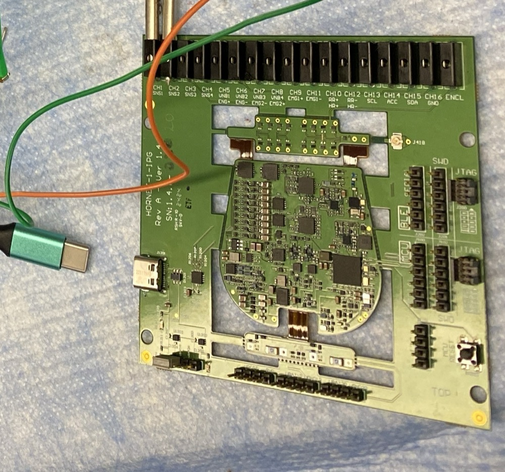

# OpenNerve development board

**Repo:** [CARSSCenter/OpenNerve-Implantable-Pulse-Generator](https://github.com/CARSSCenter/OpenNerve-Implantable-Pulse-Generator){ target="_blank" } — same hardware and firmware as the [Gen2 PCBA](ipg-gen2.md)

!!! danger "Not approved for human use"
    Nothing described on this page has regulatory clearance for human use. See
    [Regulatory status and disclaimers](../regulatory/status.md). The board is
    suitable for bench work and non-human research use only — see
    [What you can do with it](#what-you-can-do-with-it) below.

## What it is

The development board is a genuine OpenNerve Gen2 PCBA, retained inside its
manufacturing frame rather than trimmed down for implantation. The frame
brings every signal that would otherwise be inside an implanted enclosure out
to accessible connectors: USB-C for power and control (no battery required),
2 mm banana connectors on each of the 16 feedthrough contacts, and header
pins for both onboard microcontrollers. This is the same PCBA described on
the [Gen2 PCBA page](ipg-gen2.md) — nothing about the electronics is
different, only what surrounds them.

*Gen2 dev board, with headers for stimulation, recording, and I2C communication as well as USB-C for power and communication.*

## What you can do with it

Everything below applies to the actual, sourced Gen2 hardware and firmware
documentation already on this site — the development board is simply the
form factor that gets you access to it on a bench:

- **Stimulation and impedance measurement** — set square-wave (to 1200 Hz) or
  low-frequency sine-wave (1-15 Hz) stimulation parameters and read channel impedance
  from the Windows control app. See the synced
  [Getting started guide](../software/windows/getting-started.md).
- **Biosignal recording** — two of the four configurable analog front ends (AFEs) are exposed as header pins for easy
  ECG, EMG, or eCAP/ENG recording; filter, gain, and sampling-rate figures
  for each are in the [Getting started guide](../software/windows/getting-started.md#sensing).
- **Firmware development** — flash the STM32 MCU firmware or the shared
  nRF52810 BLE firmware directly over JTAG/SWD. See the
  [MCU flashing guide](ipg/mcu-flashing.md) and
  [BLE flashing guide](ipg/ble-flashing.md).
- **Over-the-air firmware updates** — push a new firmware image over BLE
  without a wired connection. See the
  [OTA firmware update guide](ipg/ota-updates.md). Powering the board from
  USB disables the magnetic switch, so waking it after an OTA update uses the
  reset button instead — noted in that guide.
  ([source](https://github.com/CARSSCenter/OpenNerve-Implantable-Pulse-Generator/blob/main/Tools/ota_updater/user-guide.md))
- **On-device log capture** — download and clear logs recorded internally by
  the IPG firmware. See the [Logging guide](ipg/logging.md).
- **Third-party digital sensors** — the board's I2C port supports the AMS
  motion-sensing lead today, and is open to other digital sensors under
  development. See [Standard Leads](standard-leads.md).

## Specifications

Stimulation and AFE (analog front end) specifications for the Gen2 PCBA, as sourced
in the OpenNerve IPG flyer (internal document, not yet published to a public repo —
see the note below).

### Stimulation parameters

| Stimulation parameter | Minimum | Maximum | Step |
|---|---|---|---|
| Amplitude, mA | 0.2 | 5 | 0.1 |
| Pulse width, µs | 100 | 800 | 50 |
| Frequency, Hz | 1 | 1200 | 1 |
| Output limits, V | 0 | 11 | — |
| Ramp up/down duration, s | 0 | 10 | 1 |
| Train on/off duration, s | 10 | 300 | 10 |

### AFE specifications

| AFE specification | ECG HR | ECG RR | eCAP | EMG |
|---|---|---|---|---|
| High-pass filter, Hz | 0.5 | 0.09 | 7.97 | 0.4 |
| Low-pass filter, Hz | 83.8 | 0.73 | 1,750 | 665 |
| Amplitude min LSB, ±µV | 2.8 | 2.8 | 0.37 | 1.4 |
| Amplitude max at 14 bit, ±mV | 24 | 24 | 3 | 48 |
| Gain for ADC Vref = ±3V | 125 | 117 | 1,005 | 250 |
| Recommended ADC freq., Hz | 256 | 256 | 6,400 | 2,560 |

ECG: electrocardiography. RR: respiratory rate. eCAP: evoked compound action
potential.

## How to get one

Development boards can be manufactured using the open source PCBA files available in the repository, or procured directly from OpenNerve (contact **Open.Nerve@usc.edu** to ask about availability).

## Documentation

- [Getting started](../software/windows/getting-started.md)
- [MCU flashing guide](ipg/mcu-flashing.md)
- [BLE flashing guide](ipg/ble-flashing.md)
- [OTA firmware update guide](ipg/ota-updates.md)
- [Logging guide](ipg/logging.md)
- [Gen2 PCBA](ipg-gen2.md) — the underlying hardware this board carries
