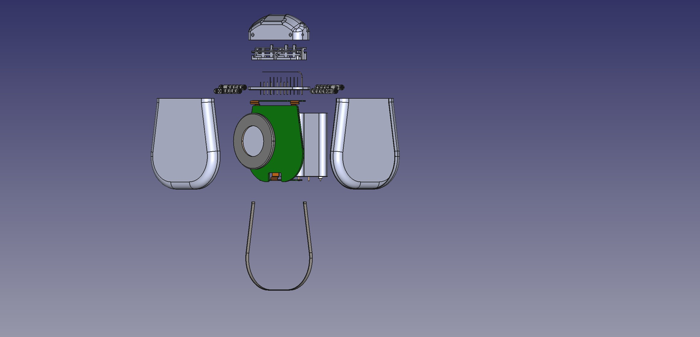

# Implantable Pulse Generator (IPG)

**Repo:** [CARSSCenter/OpenNerve-Implantable-Pulse-Generator](https://github.com/CARSSCenter/OpenNerve-Implantable-Pulse-Generator)

!!! danger "Not approved for human use"
    Nothing described on this page has regulatory clearance for human use.
    See [Regulatory status and disclaimers](../regulatory/status.md).

*Exploded view of IPG.*

## What it is

The IPG provides current-based bipolar electrical stimulation, records
biosignals using built-in analog front ends, and can connect to third-party
sensors over an in-body I2C network. It communicates with a controller over
Bluetooth Low Energy (BLE) and can be charged inductively. Two microcontrollers are
used: an nRF52810 for BLE, and an STM32 ("MCU") for most other functions.
([source](https://github.com/CARSSCenter/OpenNerve-Implantable-Pulse-Generator/blob/main/README.md))

Two PCB revisions exist with different channel counts and stimulation
capability. Each has its own maturity, evidence, and BOM/fab-notes page — see
[Gen1 vs. Gen2](#gen1-vs-gen2) below. **Currently, only the Gen2 PCBA is under active development.**

The Gen2 PCBA is also available as a bench-friendly
[development board](dev-board.md) — the same hardware, retained in its
manufacturing frame with USB-C power and breakout connectors, rather than
trimmed down for implantation.

## Gen1 vs. Gen2

| | [Gen2 PCBA](ipg-gen2.md) | [Gen1 PCBA](ipg-gen1.md) |
|---|---|---|
| Stimulation channels | 2 fully independent bipolar (square wave to 1200 Hz, or low-frequency sine wave) | 8 pseudo-independent monopolar |
| Biosignal AFEs | 4 differential (ECG/EMG/eCAP) | 2 differential (ECG/EMG/eCAP) |
| MCU firmware | `Gen2 PCBA/FW-MCU-H2/` — revision-specific | `Gen1 PCBA/FW-MCU-H1-251201.hex` — revision-specific |
| BLE firmware | `FW-BLE/` — shared between versions |
| Design files released | Altium source files (schematic & layout), BOM, STEP   | Altium schematics & layout, BOM, assembly drawing, fabrication drawing, test-point deck |

Both revisions share the same enclosure family (versioned independently, last release
rev 0.7 — see either revision page) and the same BLE firmware. **Note:** as of March 2026 Windows control software backwards compatibility has now been broken; work would be needed to restore compatibility with Gen1 IPGs.

## Maturity

Evidence
E2
Acute in vivo

Manufacturing Readiness
M3
GMP-capable

[Maturity levels](../regulatory/maturity.md). refer to the packaged IPG. For maturity levels when using the PCBA as a development board, see [Gen2 PCBA maturity](ipg-gen2.md#maturity) and
[Gen1 PCBA maturity](ipg-gen1.md#maturity). 

!!! note "Standing disclaimer"
    These levels describe testing history and documentation state. They are
    not regulatory clearance and not a safety endorsement.

## Control Software
Two software platforms exist for sending control signals to and streaming data from the OpenNerve IPG. The Windows app is under active development and is used for research across multiple working groups. The Android app has only been used for design verification testing, and is not considered mature.

- Windows app — see [Windows software page](../software/windows.md).
- Android app, in development — see [Android software page](../software/android.md).
  Both require an encryption key exchange with the IPG firmware; contact
  open.nerve@usc.edu for the shared development key, or use the encryption guide
  (linked below) to generate your own.
  ([source](https://github.com/CARSSCenter/OpenNerve-Windows-App/blob/main/README.md))

## Charging

The IPG can be charged inductively using the [OpenNerve Charger](charger.md).

# Documentation

## Design History Files

Design Output Review

<a class="on-pdf__fallback" href="https://raw.githubusercontent.com/CARSSCenter/OpenNerve-Implantable-Pulse-Generator/main/Docs/DHF-Files/Nest%201-IPG%20and%20Charger%20-%20Design%20Output%20Review.pdf">Open directly &#8599;</a>

Mechanical Specifications

<a class="on-pdf__fallback" href="https://raw.githubusercontent.com/CARSSCenter/OpenNerve-Implantable-Pulse-Generator/main/Docs/DHF-Files/Nest%201-IPG%20and%20Charger%20-%20Mechanical%20Specifications.pdf">Open directly &#8599;</a>

Test Plan

<a class="on-pdf__fallback" href="https://raw.githubusercontent.com/CARSSCenter/OpenNerve-Implantable-Pulse-Generator/main/Docs/DHF-Files/Nest%201-IPG%20and%20Charger%20Test%20Plan%20.pdf">Open directly &#8599;</a>

Mechanical Design Images

<a class="on-pdf__fallback" href="https://raw.githubusercontent.com/CARSSCenter/OpenNerve-Implantable-Pulse-Generator/main/Docs/DHF-Files/Nest%201-IPG%20and%20Charger-Mechanical%20Design%20Images.pdf">Open directly &#8599;</a>

## DVT Protocols

`Docs/Testing-Protocols/` contains eight PDFs, each named "Hornet IPG … DVT
Protocol". Each viewer below fetches its PDF live from the repo's default
branch — click a title to expand it:

Accelerated aging DVT protocol

<a class="on-pdf__fallback" href="https://raw.githubusercontent.com/CARSSCenter/OpenNerve-Implantable-Pulse-Generator/main/Docs/Testing-Protocols/Hornet%20IPG%20Accelerated%20Aging%20DVT%20Protocol.pdf">Open directly &#8599;</a>

Drop &amp; impact DVT protocol

<a class="on-pdf__fallback" href="https://raw.githubusercontent.com/CARSSCenter/OpenNerve-Implantable-Pulse-Generator/main/Docs/Testing-Protocols/Hornet%20IPG%20Drop%20%26%20Impact%20%20DVT%20Protocol.pdf">Open directly &#8599;</a>

Heating during normal operation DVT protocol

<a class="on-pdf__fallback" href="https://raw.githubusercontent.com/CARSSCenter/OpenNerve-Implantable-Pulse-Generator/main/Docs/Testing-Protocols/Hornet%20IPG%20Heating%20Test%20During%20Normal%20Operation%20DVT%20Protocol.pdf">Open directly &#8599;</a>

Hermeticity DVT protocol

<a class="on-pdf__fallback" href="https://raw.githubusercontent.com/CARSSCenter/OpenNerve-Implantable-Pulse-Generator/main/Docs/Testing-Protocols/Hornet%20IPG%20Hermeticity%20DVT%20Protocol.pdf">Open directly &#8599;</a>

Minor mechanical shock DVT protocol

<a class="on-pdf__fallback" href="https://raw.githubusercontent.com/CARSSCenter/OpenNerve-Implantable-Pulse-Generator/main/Docs/Testing-Protocols/Hornet%20IPG%20Minor%20Mechanical%20Shock%20DVT%20Protocol.pdf">Open directly &#8599;</a>

RGA DVT protocol

<a class="on-pdf__fallback" href="https://raw.githubusercontent.com/CARSSCenter/OpenNerve-Implantable-Pulse-Generator/main/Docs/Testing-Protocols/Hornet%20IPG%20RGA%20DVT%20Protocol.pdf">Open directly &#8599;</a>

Shear force DVT protocol

<a class="on-pdf__fallback" href="https://raw.githubusercontent.com/CARSSCenter/OpenNerve-Implantable-Pulse-Generator/main/Docs/Testing-Protocols/Hornet%20IPG%20Shear%20Force%20DVT%20Protocol.pdf">Open directly &#8599;</a>

Vibration mechanical force DVT protocol

<a class="on-pdf__fallback" href="https://raw.githubusercontent.com/CARSSCenter/OpenNerve-Implantable-Pulse-Generator/main/Docs/Testing-Protocols/Hornet%20IPG%20Vibration%20Mechanical%20Force%20DVT%20Protocol.pdf">Open directly &#8599;</a>

## Documentation synced from the upstream repo

The following documentation is available in the IPG's repository and has been mirrored here for convenience. Please submit pull requests for edits in the original document, not on this website!

- [Getting started](ipg/getting-started.md)
- [MCU flashing guide](ipg/mcu-flashing.md)
- [BLE flashing guide](ipg/ble-flashing.md)
- [OTA firmware update guide](ipg/ota-updates.md)
- [Logging guide](ipg/logging.md)
- [Magnetic switch guide](ipg/magnetic-switch.md)
- [Encryption instructions](ipg/encryption.md)
- [Charging (CAR-212)](ipg/charging.md)
- [WPT implementation report](ipg/wpt-report.md)
- [Impedance measurement strategy](ipg/impedance.md)
- [Tools: sine wave generator](ipg/tools-sine-wave-generator.md) — bench tool for
  testing neuromodulation hardware, from the repo's `Tools/` directory
- [Tools: OTA updater user guide](ipg/tools-ota-updater.md) — CLI tool for
  wireless Gen2 firmware updates over BLE, also from `Tools/`

