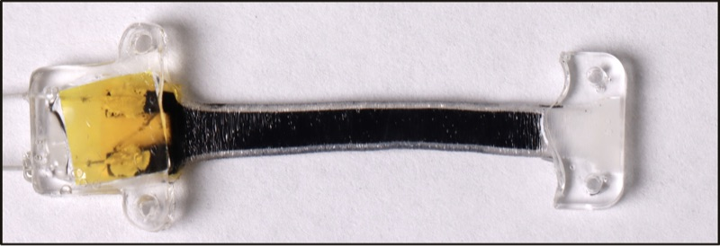

# Mechanical Sensors

**Repo:** [CARSSCenter/Mechanical-Sensors](https://github.com/CARSSCenter/Mechanical-Sensors)

!!! danger "Not approved for human use"
    Nothing described on this page has regulatory clearance for human use.
    See [Regulatory status and disclaimers](../regulatory/status.md).

## About Mechanical Sensors

Sensors for mechanical biomarkers designed to interface with the OpenNerve
platform:

- A **capacitive strain sensor**, manufactured from silicone rubber and a
  wrinkled Parylene C process intended to increase gauge factor.
- A **temperature sensor**, manufactured from gold on a polyimide thin-film
  substrate.

([source](https://github.com/CARSSCenter/Mechanical-Sensors/blob/main/README.md))

*A capacitive implantable strain sensor designed for integration with OpenNerve.*

## Documentation synced from the upstream repo

The pages below are pulled from the Mechanical-Sensors repo by
`tools/sync_docs.py` — each carries a banner recording the exact upstream
commit it reflects. Edit them upstream, not here.

- [Strain sensor troubleshooting](mechanical-sensors/strain-troubleshooting.md)
- [Strain sensor: CapSense PCB integration](mechanical-sensors/strain-capsense-integration.md)
- [Temperature sensor calibration & characterization](mechanical-sensors/temperature-calibration.md)
- [Temperature sensor design & fabrication](mechanical-sensors/temperature-fabrication.md)

## Maturity

Evidence
E2
Acute in vivo

Manufacturing readiness
M1
Lab reproducible

See [Maturity level definitions](../regulatory/maturity.md).
