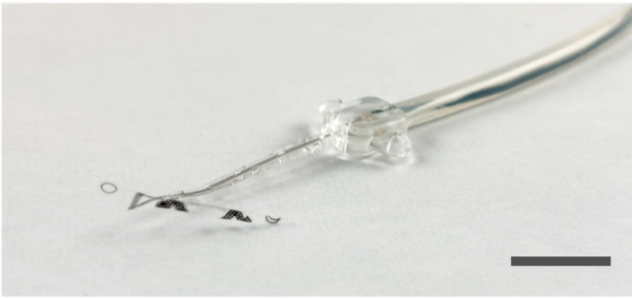

# Sub-mm Parylene Cuff Electrode

**Repo:** [CARSSCenter/Sub-mm-Parylene-Cuff-Electrode](https://github.com/CARSSCenter/Sub-mm-Parylene-Cuff-Electrode)

!!! danger "Not approved for human use"
    Nothing described on this page has regulatory clearance for human use.
    See [Regulatory status and disclaimers](../regulatory/status.md).

## About

A nerve cuff for sub-millimeter diameter branch nerves, microfabricated from
thin-film Parylene C with platinum electrodes and contacts, using a unique
three-dimensional geometry for surgical placement. Manufactured from
thin-film Parylene C and platinum, then thermoformed into shape.
([source](https://github.com/CARSSCenter/Sub-mm-Parylene-Cuff-Electrode/blob/main/README.md))

*A sub-mm nerve cuff microfabricated from Parylene C and platinum and packaged for integration with OpenNerve IPG. Scale bar is 1 cm.*

## Maturity

Evidence
E3
Chronic in vivo

Manufacturing readiness
M1
Lab-reproducible

See [Maturity level definitions](../regulatory/maturity.md).

## Supporting documents in the repo

Documentation pulled from the OpenNerve repository describing fabrication
protocols, design rationale, and benchtop testing. Each viewer below fetches
its PDF live from the repo's default branch — click a title to expand it:

Design Selection Summary (Rev 1, updated)

<a class="on-pdf__fallback" href="https://raw.githubusercontent.com/CARSSCenter/Sub-mm-Parylene-Cuff-Electrode/main/Design%20Selection%20Summary%20(Rev%201_updated).pdf">Open directly &#8599;</a>

CAD Model Summary (Rev 1)

<a class="on-pdf__fallback" href="https://raw.githubusercontent.com/CARSSCenter/Sub-mm-Parylene-Cuff-Electrode/main/CAD%20Model%20Summary%20(Rev%201).pdf">Open directly &#8599;</a>

Thin Film Fabrication Protocol (Rev 2)

<a class="on-pdf__fallback" href="https://raw.githubusercontent.com/CARSSCenter/Sub-mm-Parylene-Cuff-Electrode/main/Thin%20Film%20Fabrication%20Protocol%20(Rev%202).pdf">Open directly &#8599;</a>

Full Fabrication Protocol (Rev 2)

<a class="on-pdf__fallback" href="https://raw.githubusercontent.com/CARSSCenter/Sub-mm-Parylene-Cuff-Electrode/main/Full%20Fabrication%20Protocol%20(Rev%202).pdf">Open directly &#8599;</a>

Electrochemical Testing Summary

<a class="on-pdf__fallback" href="https://raw.githubusercontent.com/CARSSCenter/Sub-mm-Parylene-Cuff-Electrode/main/Electrochemical%20Testing%20Summary.pdf">Open directly &#8599;</a>

Lifetime Testing Protocol (Rev 1)

<a class="on-pdf__fallback" href="https://raw.githubusercontent.com/CARSSCenter/Sub-mm-Parylene-Cuff-Electrode/main/Lifetime%20Testing%20Protocol%20(Rev%201).pdf">Open directly &#8599;</a>

