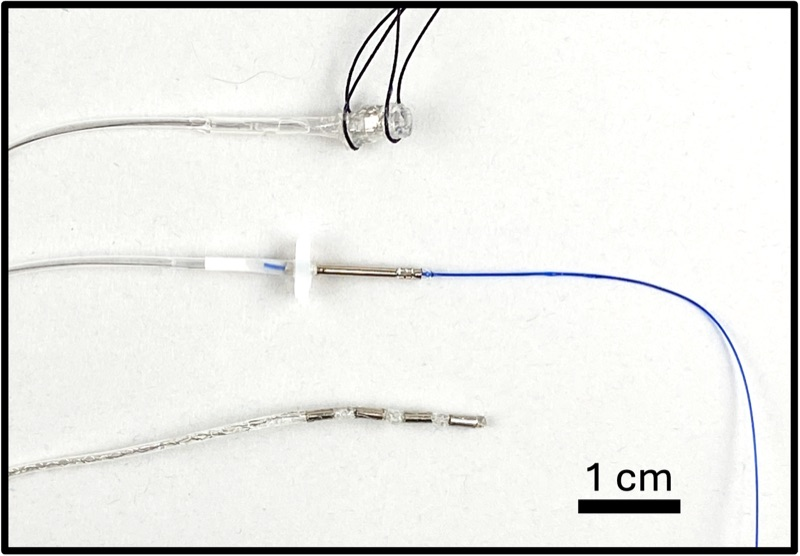

# Standard Leads

**Repo:** [CARSSCenter/OpenNerve-Standard-Leads](https://github.com/CARSSCenter/OpenNerve-Standard-Leads)

!!! danger "Not approved for human use"
    Nothing described on this page has regulatory clearance for human use.
    See [Regulatory status and disclaimers](../regulatory/status.md).

*Three of the standard leads manufactured by Med-Ally. Top: a 2mm diameter bipolar nerve cuff. Middle: an intramuscular EMG lead with integrated suture. Bottom: a linear array for SNS or SCS.*

## What they are

A library of leads that interface with the OpenNerve IPG, designed to be
manufacturable under GMP by Med-Ally LLC using standard manufacturing
processes:

- **VNS cuff electrode** — two radial platinum-iridium electrodes, 1 mm wide,
  6 mm spacing, in a silicone cuff. Targets nerves 1–3.5 mm in diameter (e.g.
  cervical vagus).
- **SNS linear electrode** — four platinum-iridium electrodes, 3 mm wide,
  3 mm spacing, with anchor features for in vivo positioning. Targets sacral
  or other peripheral nerve stimulation.
- **EMG needle electrode** — platinum-iridium needle electrode with suture
  needle; two can be paired for bipolar recording.
- **ECG electrode** — two electrodes, 3 mm long, 80 mm spacing, based on the
  Boston Scientific 3400 S-ICD lead.
- **AMS motion sensing lead** — an
  [MIS2DH](https://www.st.com/en/mems-and-sensors/mis2dh.html) accelerometer
  encapsulated in silicone, communicating with the IPG over I2C.

([source](https://github.com/CARSSCenter/OpenNerve-Standard-Leads/blob/main/README.md))

## Maturity

Evidence
E3
Chronic in vivo

Manufacturing readiness
M3
GMP-capable

# Documentation

## Nest 3 design files

Four PDFs at the top level of the repo cover the mechanical design,
specifications, and test plan for all five leads. Each viewer below fetches
its PDF live from the repo's default branch — click a title to expand it:

Design File Set

<a class="on-pdf__fallback" href="https://raw.githubusercontent.com/CARSSCenter/OpenNerve-Standard-Leads/main/Nest%203%20-%20Leads%20-%20Design%20File%20Set.pdf">Open directly &#8599;</a>

Mechanical Specifications

<a class="on-pdf__fallback" href="https://raw.githubusercontent.com/CARSSCenter/OpenNerve-Standard-Leads/main/Nest%203-Leads%20-%20Mechanical%20Specifications.pdf">Open directly &#8599;</a>

Test Plan

<a class="on-pdf__fallback" href="https://raw.githubusercontent.com/CARSSCenter/OpenNerve-Standard-Leads/main/Nest%203-Leads%20Test%20Plan.pdf">Open directly &#8599;</a>

Mechanical Design and Assembly Images

<a class="on-pdf__fallback" href="https://raw.githubusercontent.com/CARSSCenter/OpenNerve-Standard-Leads/main/Nest%203-Leads%20-%20Mechanical%20Design%20and%20Assembly%20Images.pdf">Open directly &#8599;</a>

## AMS lead PCBA

The AMS motion-sensing lead carries its own board ("XLBoard") holding the
MIS2DH accelerometer. The drawings below are the current revision (Ver 1.1
Rev A, July 2025):

Schematic

<a class="on-pdf__fallback" href="https://raw.githubusercontent.com/CARSSCenter/OpenNerve-Standard-Leads/main/AMS%20Lead%20PCBA/XLBoard%20sch.PDF">Open directly &#8599;</a>

Board layout and fabrication drawing

<a class="on-pdf__fallback" href="https://raw.githubusercontent.com/CARSSCenter/OpenNerve-Standard-Leads/main/AMS%20Lead%20PCBA/XLBoard.PDF">Open directly &#8599;</a>

An earlier revision of the XLBoard schematic and layout is retained upstream
in the repo's
[`AMS Lead PCBA/Old/`](https://github.com/CARSSCenter/OpenNerve-Standard-Leads/tree/main/AMS%20Lead%20PCBA/Old)
folder and is not reproduced here.

