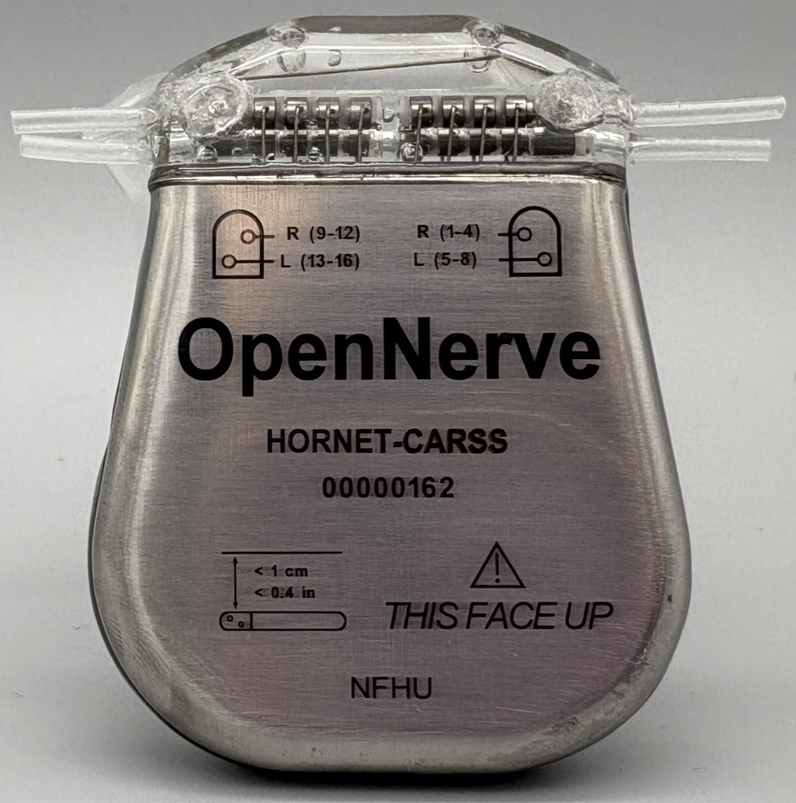
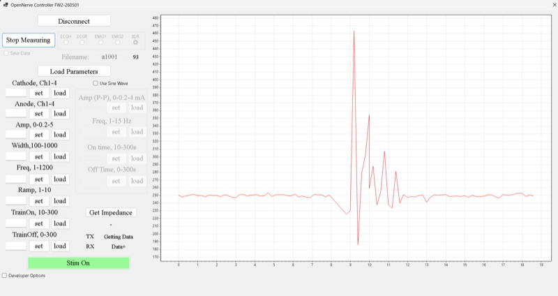
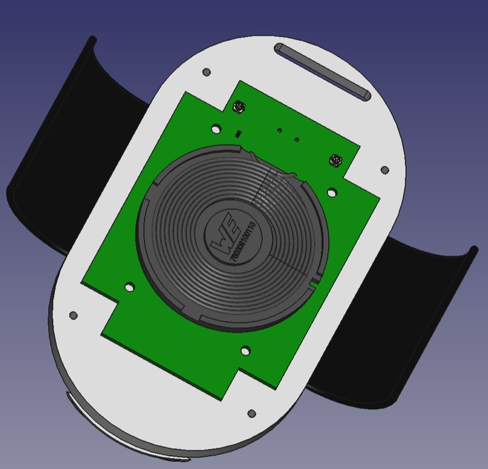
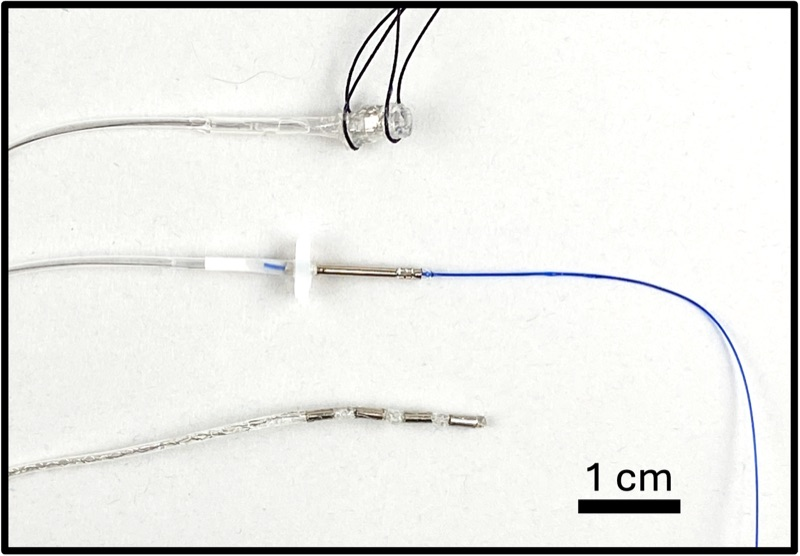
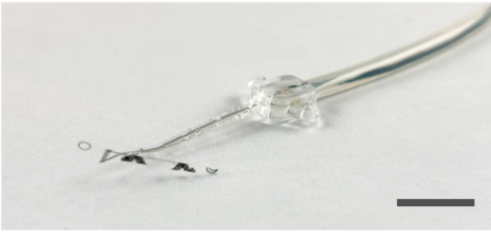
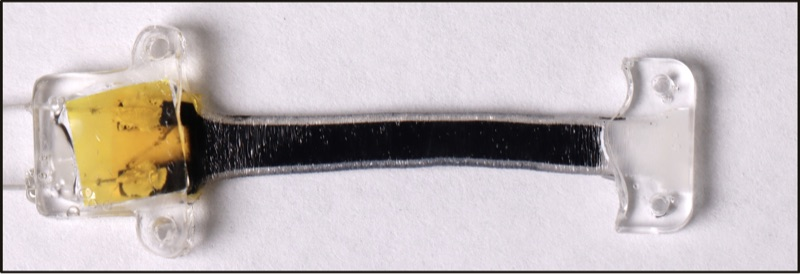
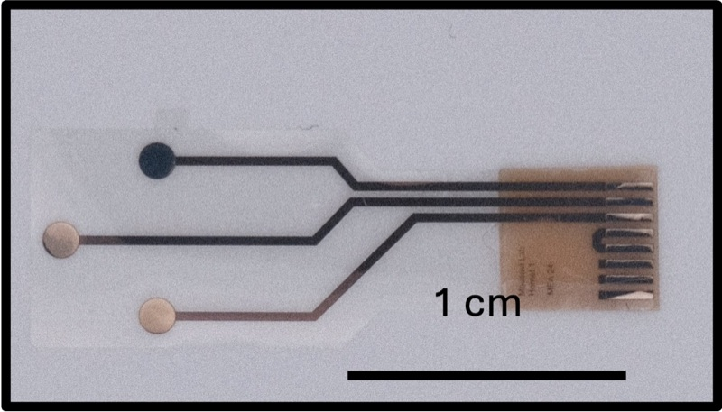
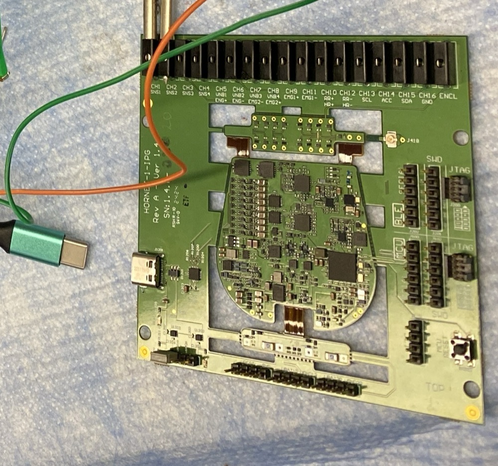

**Draft — internal review.** This site is a working draft circulated for
feedback. Do
not distribute outside the review group.

<svg viewBox="0 0 1600 460" preserveAspectRatio="none" xmlns="http://www.w3.org/2000/svg" aria-hidden="true" focusable="false">
  <path class="on-hero__trace" pathLength="1" d="M 0.0,60.0 Q 0.0,60.0 86.6,60.0 Q 173.1,60.0 180.5,40.9 Q 187.9,21.8 200.1,47.0 Q 212.4,72.2 225.5,66.1 Q 238.6,60.0 301.6,60.0 Q 364.7,60.0 371.2,41.9 Q 377.7,23.7 388.6,47.7 Q 399.4,71.6 411.0,65.8 Q 422.6,60.0 467.4,60.0 Q 512.1,60.0 518.8,41.8 Q 525.4,23.6 536.4,47.6 Q 547.5,71.7 559.3,65.8 Q 571.1,60.0 661.9,60.0 Q 752.7,60.0 758.5,49.3 Q 764.4,38.6 774.0,52.7 Q 783.7,66.8 794.0,63.4 Q 804.3,60.0 844.4,60.0 Q 884.4,60.0 891.2,36.4 Q 898.0,12.9 909.3,44.0 Q 920.6,75.1 932.6,67.5 Q 944.7,60.0 977.0,60.0 Q 1009.3,60.0 1016.8,33.3 Q 1024.2,6.6 1036.7,41.9 Q 1049.1,77.1 1062.4,68.5 Q 1075.7,60.0 1153.6,60.0 Q 1231.4,60.0 1236.9,39.9 Q 1242.3,19.8 1251.4,46.3 Q 1260.4,72.9 1270.1,66.4 Q 1279.8,60.0 1317.0,60.0 Q 1354.2,60.0 1359.4,41.5 Q 1364.6,23.0 1373.2,47.4 Q 1381.9,71.8 1391.1,65.9 Q 1400.3,60.0 1500.2,60.0 L 1600.0,60.0" fill="none" stroke="#0BC1F9" stroke-opacity="0.16" stroke-width="2.5" stroke-linecap="round" stroke-linejoin="round"/>
  <path class="on-hero__trace" pathLength="1" d="M 0.0,150.0 Q 0.0,150.0 162.8,150.0 Q 325.5,150.0 335.3,123.9 Q 345.0,97.9 361.2,132.3 Q 377.4,166.7 394.6,158.3 Q 411.9,150.0 458.7,150.0 Q 505.4,150.0 513.5,130.3 Q 521.7,110.7 535.3,136.6 Q 548.8,162.6 563.3,156.3 Q 577.8,150.0 675.4,150.0 Q 773.0,150.0 780.3,138.7 Q 787.7,127.3 800.0,142.3 Q 812.3,157.3 825.3,153.6 Q 838.4,150.0 929.3,150.0 Q 1020.1,150.0 1028.4,137.0 Q 1036.6,124.0 1050.4,141.2 Q 1064.1,158.3 1078.8,154.2 Q 1093.4,150.0 1138.4,150.0 Q 1183.4,150.0 1192.5,139.5 Q 1201.6,128.9 1216.7,142.8 Q 1231.9,156.7 1248.1,153.4 Q 1264.3,150.0 1345.9,150.0 Q 1427.4,150.0 1436.6,131.8 Q 1445.8,113.5 1461.1,137.6 Q 1476.4,161.7 1492.8,155.8 Q 1509.1,150.0 1554.6,150.0 L 1600.0,150.0" fill="none" stroke="#0BC1F9" stroke-opacity="0.1" stroke-width="2.5" stroke-linecap="round" stroke-linejoin="round"/>
  <path class="on-hero__trace" pathLength="1" d="M 0.0,245.0 Q 0.0,245.0 73.4,245.0 Q 146.7,245.0 152.7,221.5 Q 158.6,198.0 168.6,229.0 Q 178.5,260.1 189.1,252.5 Q 199.8,245.0 239.1,245.0 Q 278.5,245.0 283.9,222.2 Q 289.4,199.4 298.5,229.5 Q 307.6,259.6 317.3,252.3 Q 326.9,245.0 391.8,245.0 Q 456.6,245.0 460.7,234.0 Q 464.8,223.0 471.6,237.5 Q 478.4,252.0 485.6,248.5 Q 492.9,245.0 545.3,245.0 Q 597.8,245.0 602.3,222.6 Q 606.9,200.1 614.4,229.7 Q 622.0,259.4 630.1,252.2 Q 638.1,245.0 694.9,245.0 Q 751.6,245.0 757.3,230.3 Q 763.1,215.6 772.6,235.0 Q 782.2,254.4 792.4,249.7 Q 802.6,245.0 881.5,245.0 Q 960.4,245.0 966.4,228.8 Q 972.5,212.5 982.5,234.0 Q 992.6,255.4 1003.4,250.2 Q 1014.1,245.0 1039.2,245.0 Q 1064.3,245.0 1070.1,221.4 Q 1075.9,197.7 1085.6,228.9 Q 1095.3,260.1 1105.6,252.6 Q 1115.9,245.0 1147.8,245.0 Q 1179.7,245.0 1184.9,223.3 Q 1190.0,201.6 1198.6,230.2 Q 1207.2,258.9 1216.4,251.9 Q 1225.6,245.0 1308.0,245.0 Q 1390.4,245.0 1395.6,232.2 Q 1400.7,219.4 1409.2,236.3 Q 1417.7,253.2 1426.8,249.1 Q 1435.9,245.0 1481.3,245.0 Q 1526.7,245.0 1531.3,224.5 Q 1536.0,204.0 1543.8,231.1 Q 1551.5,258.1 1559.8,251.6 Q 1568.1,245.0 1584.0,245.0 L 1600.0,245.0" fill="none" stroke="#0BC1F9" stroke-opacity="0.18" stroke-width="2.5" stroke-linecap="round" stroke-linejoin="round"/>
  <path class="on-hero__trace" pathLength="1" d="M 0.0,335.0 Q 0.0,335.0 115.6,335.0 Q 231.3,335.0 239.8,313.4 Q 248.3,291.8 262.5,320.3 Q 276.7,348.8 291.8,341.9 Q 307.0,335.0 354.9,335.0 Q 402.9,335.0 411.0,324.8 Q 419.1,314.6 432.7,328.1 Q 446.2,341.5 460.7,338.3 Q 475.2,335.0 536.2,335.0 Q 597.2,335.0 605.3,319.3 Q 613.4,303.6 626.9,324.3 Q 640.4,345.0 654.8,340.0 Q 669.2,335.0 718.4,335.0 Q 767.6,335.0 774.8,309.6 Q 781.9,284.3 793.9,317.7 Q 805.9,351.2 818.6,343.1 Q 831.4,335.0 873.9,335.0 Q 916.5,335.0 923.9,309.5 Q 931.3,284.0 943.7,317.6 Q 956.0,351.3 969.2,343.2 Q 982.4,335.0 1024.2,335.0 Q 1066.0,335.0 1074.0,310.9 Q 1081.9,286.8 1095.3,318.6 Q 1108.6,350.4 1122.8,342.7 Q 1137.0,335.0 1232.9,335.0 Q 1328.7,335.0 1337.4,314.2 Q 1346.0,293.3 1360.3,320.8 Q 1374.7,348.3 1390.0,341.7 Q 1405.4,335.0 1502.7,335.0 L 1600.0,335.0" fill="none" stroke="#0BC1F9" stroke-opacity="0.09" stroke-width="2.5" stroke-linecap="round" stroke-linejoin="round"/>
  <path class="on-hero__trace" pathLength="1" d="M 0.0,415.0 Q 0.0,415.0 64.6,415.0 Q 129.2,415.0 135.2,393.7 Q 141.2,372.3 151.2,400.5 Q 161.2,428.7 171.9,421.8 Q 182.6,415.0 266.9,415.0 Q 351.1,415.0 356.1,402.7 Q 361.1,390.3 369.4,406.6 Q 377.8,422.9 386.7,418.9 Q 395.5,415.0 435.3,415.0 Q 475.2,415.0 481.3,401.9 Q 487.4,388.9 497.6,406.1 Q 507.8,423.4 518.7,419.2 Q 529.6,415.0 565.6,415.0 Q 601.5,415.0 606.5,396.4 Q 611.4,377.9 619.7,402.4 Q 628.0,426.9 636.8,420.9 Q 645.6,415.0 695.1,415.0 Q 744.7,415.0 751.0,398.2 Q 757.4,381.5 768.0,403.6 Q 778.6,425.7 789.9,420.4 Q 801.2,415.0 868.1,415.0 Q 935.0,415.0 940.1,405.7 Q 945.2,396.5 953.7,408.7 Q 962.2,420.9 971.2,418.0 Q 980.3,415.0 1019.5,415.0 Q 1058.8,415.0 1065.1,390.3 Q 1071.4,365.6 1081.9,398.2 Q 1092.4,430.8 1103.6,422.9 Q 1114.8,415.0 1194.0,415.0 Q 1273.2,415.0 1279.4,391.1 Q 1285.5,367.3 1295.8,398.8 Q 1306.0,430.3 1317.0,422.6 Q 1327.9,415.0 1418.3,415.0 Q 1508.7,415.0 1513.7,391.7 Q 1518.8,368.4 1527.2,399.2 Q 1535.6,429.9 1544.6,422.5 Q 1553.6,415.0 1576.8,415.0 L 1600.0,415.0" fill="none" stroke="#0BC1F9" stroke-opacity="0.13" stroke-width="2.5" stroke-linecap="round" stroke-linejoin="round"/>
</svg>

# An open platform for translational neuromodulation research { .on-hero__title }

Implantable pulse generator, stimulation and recording leads, digital sensors, wireless charger, and control software. All open source.
{: .on-hero__subhead }

Up to <strong>1200 Hz</strong> square wave stimulation (current-driven)
1 - 15 Hz <strong>sine wave</strong> for stimulation or block
4 independent <strong>biosignal front-ends </strong>(EMG, ECG, eCAPs)
<strong>Leads </strong> for stimulation, electrical recording, and biomarker sensing
<strong>Fully Open Source</strong> (CC-BY-4.0)

<!--
Figures per [Platform architecture](start/architecture.md#two-ipg-hardware-generations)
and [IPG: Gen1 vs. Gen2](components/ipg.md#gen1-vs-gen2).
{: .on-specs__cite }
-->

**Preclinical research use only.** No component has regulatory clearance for
human use. [Full status and disclaimers →](regulatory/status.md)

[Meet the community](https://github.com/axbaldwin1/opennerve-site/discussions/new?category=q-a){ .md-button .md-button--primary }
[View on GitHub](https://github.com/CARSSCenter){ .md-button }

{: .on-hero__photo }

<!-- One assembled OpenNerve IPG unit, serial `00000162`.
{: .on-hero__caption } -->

## How to work with OpenNerve

Learn about OpenNerve

Learn more about OpenNerve and explore the components and documentation.

- [What is OpenNerve?](start/overview.md)
- [Component overview](components/index.md)
- [IPG specifications](components/ipg.md)

Use OpenNerve Components

Contact us for development boards and hardware collaboration, or create your own system using our open-source files.

- [Get a development board](components/dev-board.md)
- [Contact us for collaborations](mailto:carss@usc.edu)
- [Clone a repository](https://github.com/CARSSCenter)

Join our Community

Contribute to OpenNerve, get technical support, and make neuroscience better. Hardware, firmware, software, and documentation all take contributions.

- [How to contribute](contribute/index.md)

## The OpenNerve platform

The core implantable pulse generator (or equivalent development board) provides current-based stimulation, records analog biosignals such as EMG, ECG, and eCAPs, and has digital in-body communication for advanced biosensors or networked devices. 
Several stimulation / recording leads and digital sensors are being development by OpenNerve, and the platform is compatible with commercial and newly developed leads.
Bluetooth Low Energy (BLE)  allows real-time data streaming and control; a custom inductive charger allows safe recharging.
Click on each component for documentation and open source code / engineering files.

Outside the body

Control software
[{: .on-diagram__node-media } Windows app](software/windows.md){: .on-diagram__node }
[{: .on-diagram__node-media } Android appin development](software/android.md){: .on-diagram__node }

BLE

[{: .on-diagram__node-media } Charger](components/charger.md){: .on-diagram__node }

inductive

skin

Inside the body

[{: .on-diagram__node-media } IPG](components/ipg.md){: .on-diagram__node .on-diagram__node--hub }

stim / record

Leads
[{: .on-diagram__node-media } Standard Leads](components/standard-leads.md){: .on-diagram__node }
[{: .on-diagram__node-media } Sub-mm Parylene Cuff](components/parylene-cuff.md){: .on-diagram__node }

I2C

Sensors
[{: .on-diagram__node-media } Mechanical Sensors](components/mechanical-sensors.md){: .on-diagram__node }
[{: .on-diagram__node-media } Chemical Sensors](components/chemical-sensors.md){: .on-diagram__node }

<!--
Solid lines are wired connections inside the body; dashed lines cross the
skin (BLE and inductive charging); arrows show data or power direction. See
[Platform architecture](start/architecture.md) for the full write-up,
including the two IPG hardware generations and their different channel
counts.
-->

<!--

## What is actually published

Ships today

- Schematics, PCB layout, and BOM for both IPG PCBAs (`Gen1`, `Gen2`)
- STEP models for both boards and the shared enclosure (rev 0.7)
- Assembly drawing, fabrication drawing, and test-point deck — **Gen1 only**
- MCU firmware for each generation, plus BLE firmware shared by both
- Windows control app source (`ONrecorder`)
- All of the above, CC-BY-4.0

Known gaps

- Gen2 has no separate assembly drawing, fabrication drawing, or test-point
  document — Gen1 does
- Designed in Altium Designer V25 (closed source); a third-party KiCad
  converter exists, "use at your own risk"
- BOMs are `.xlsx`, not a machine-readable open format
- No tagged release and no DOI on the IPG repo — see
  [maturity level definitions](regulatory/maturity.md) for why that blocks D3
- Android app is prototype code, not a released application

Detail and sourcing: [Gen2 PCBA](components/ipg-gen2.md),
[Gen1 PCBA](components/ipg-gen1.md).

-->

<!--

## How maturity is tracked

Every component is assessed on three independent axes, always shown
separately — never combined into one score, because a composite hides
exactly the information a reader needs.

Documentation

D0 Concept
D1 Partial
D2 Reproducible
D3 Released

Evidence

E0 None
E1 Bench
E2 Acute in vivo
E3 Chronic in vivo
E4 GLP safety
E5 Clinical

Manufacturing

M0 Lab build
M1 Pilot
M2 GMP-capable
M3 GMP-built

Availability is tracked separately, not as a fourth level: files only,
purchasable, fabricate-to-order, or not currently available.

**Most levels are not yet assigned.** An unfilled cell means "not yet
assessed," not "zero." See the
[component overview and maturity table](components/index.md) and
[maturity level definitions](regulatory/maturity.md).

-->

## Development boards

A genuine OpenNerve PCBA in a frame enabling USB-C power
and control. Breakouts on all 16 feedthrough contacts for easy lab use, and
JTAG/SWD headers for flashing and debugging. Real
hardware for firmware, software, and lead development, or for small-animal
and acute large-animal studies.

[Development board specifications](components/dev-board.md){ .md-button .md-button--primary }
[Contact us about a board](mailto:carss@usc.edu){ .md-button }

{: .on-hero__photo }

OpenNerve development board (Gen1) during an acute large animal study.
{: .on-hero__caption }

