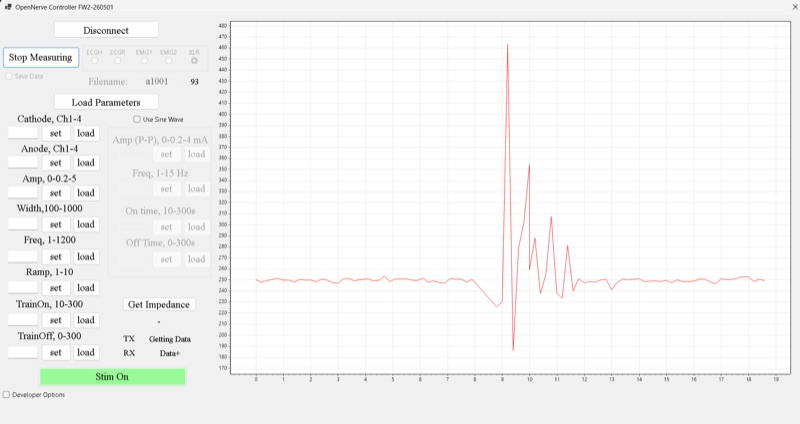

# Windows app (ONrecorder)

**Repo:** [CARSSCenter/OpenNerve-Windows-App](https://github.com/CARSSCenter/OpenNerve-Windows-App)

## What it is

A Windows desktop application (C#, .NET, WinForms) for communicating with and
controlling the OpenNerve IPG over Bluetooth Low Energy. It targets 32-bit
Windows (x86, .NET 8) and builds in Visual Studio 2022 with the .NET SDK. It
pulls in five NuGet packages at build time — ScottPlot and ScottPlot.WinForms
(plotting), MathNet.Numerics (FFT), System.IO.Ports, and
Microsoft.WindowsAppSDK — restored automatically by NuGet, so no separate
runtime install beyond the .NET 8 desktop runtime and Windows's own BLE stack
is needed to run the built app.
([source](https://github.com/CARSSCenter/OpenNerve-Windows-App/blob/main/ONrecorder.csproj))
It discovers and
connects to the IPG, performs an authentication handshake, then exchanges
control and data messages using a custom BLE protocol. It is optimized for
the Gen2 board but can target Gen1 by changing a constant in `Form1.cs`.
([source](https://github.com/CARSSCenter/OpenNerve-Windows-App/blob/main/README.md))

*The Windows app for OpenNerve allows control of stimulation and real-time streaming of data from both analog front-ends and I2C sensors.*

Admin authentication requires a private key file placed locally (not
committed to the repo); contact open.nerve@usc.edu for the shared development key,
or generate your own — see the encryption guide on the
[IPG component page](../components/ipg.md#documentation-synced-from-the-upstream-repo).

Licensed CC-BY-4.0.

## Documentation synced from the upstream repo

The following documentation is available in the Windows app's repository and has
been mirrored here for convenience. Please submit pull requests for edits in the
original document, not on this website!

- [Getting started](windows/getting-started.md)
- [Developer guide](windows/developer-guide.md)

## Maturity

Evidence
E3
Chronic in vivo

Manufacturing readiness
N/A
Not applicable to software

See [Maturity level definitions](../regulatory/maturity.md).
