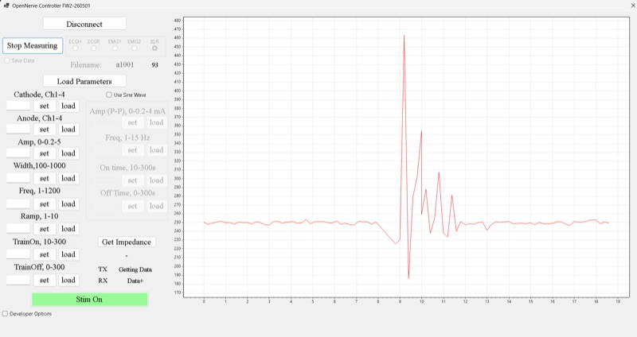
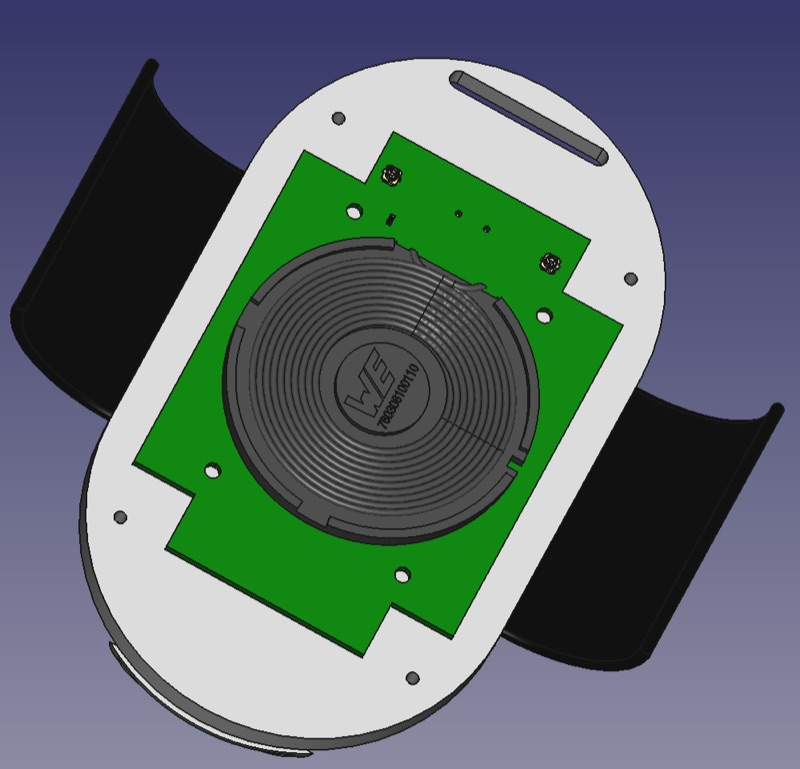
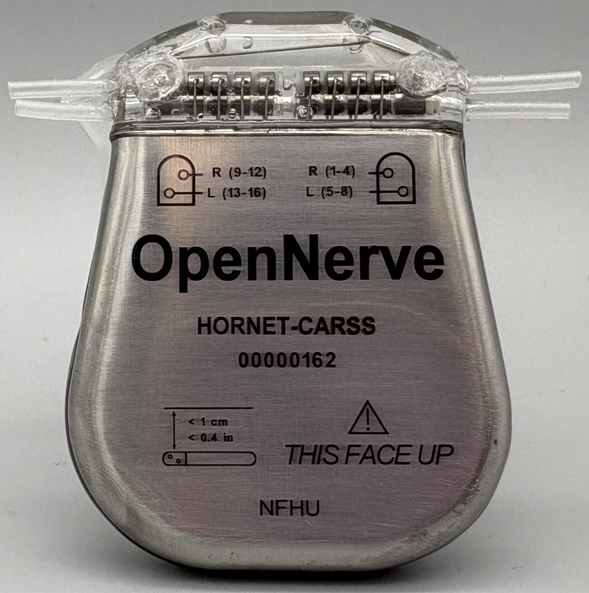
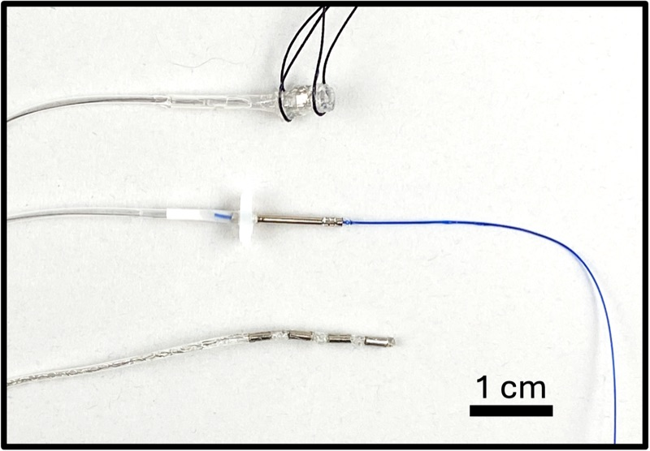
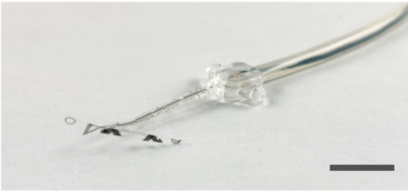
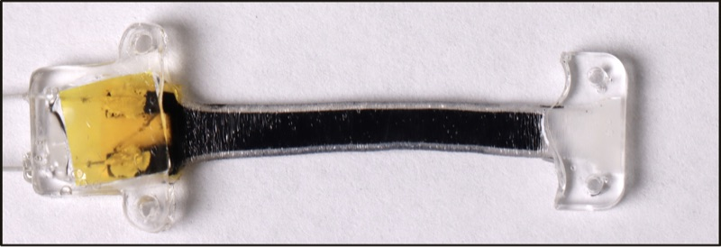
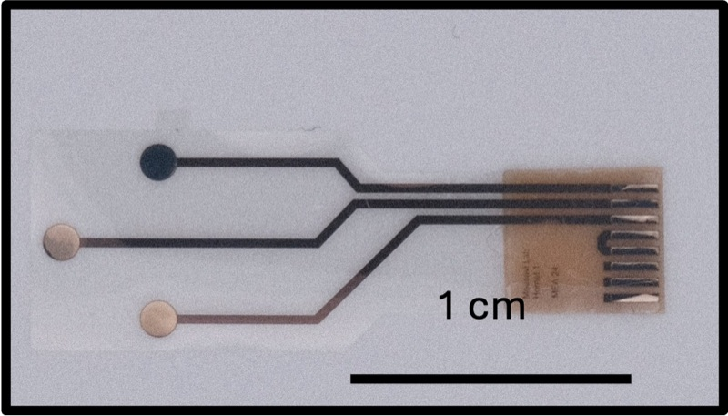

# Platform architecture

## Components and how they connect

Outside the body

Control software
[{: .on-diagram__node-media } Windows appONrecorder](../software/windows.md){: .on-diagram__node }
[{: .on-diagram__node-media } Android appin development](../software/android.md){: .on-diagram__node }

BLE

[{: .on-diagram__node-media } Charger](../components/charger.md){: .on-diagram__node }

inductive

skin

Inside the body

[{: .on-diagram__node-media } IPGGen1 · Gen2 PCBA](../components/ipg.md){: .on-diagram__node .on-diagram__node--hub }

stim / record

Leads
[{: .on-diagram__node-media } Standard Leads](../components/standard-leads.md){: .on-diagram__node }
[{: .on-diagram__node-media } Sub-mm Parylene Cuff](../components/parylene-cuff.md){: .on-diagram__node }

Bal Seal header

[Bring your own leadthird-party](../components/byo-lead.md){: .on-diagram__node }

I2C

Sensors
[{: .on-diagram__node-media } Mechanical Sensors](../components/mechanical-sensors.md){: .on-diagram__node }
[{: .on-diagram__node-media } Chemical Sensors](../components/chemical-sensors.md){: .on-diagram__node }

Solid lines are wired connections inside the body; dashed lines cross the
skin (BLE and inductive charging); arrows show data or power direction.
Same diagram as the [landing page](../index.md#the-opennerve-platform).

- The **IPG** is the hub: current-based bipolar stimulation, multiple analog
  front ends for biosignal recording, and an in-body I2C bus for third-party
  sensors. It talks to a controller over Bluetooth Low Energy and can be
  charged inductively.
  ([source](https://github.com/CARSSCenter/OpenNerve-Implantable-Pulse-Generator/blob/main/README.md))
- **Leads** connect to the IPG for stimulation, recording, or sensing,
  depending on the target nerve and study. See
  [Components](../components/index.md) for the library, or
  [Bring your own lead](../components/byo-lead.md) for the header's mating
  geometry if you want to use a different one.
- **Mechanical and chemical sensors** connect over the same I2C bus as
  third-party digital sensors.
- The **charger** inductively charges the IPG at 300 kHz and is not
  otherwise part of the signal path.
  ([source](https://github.com/CARSSCenter/OpenNerve-Charger/blob/main/README.md))
- **Control software** (Windows now, Android in development) authenticates
  to the IPG over BLE using a private/public key handshake before exchanging
  control and data messages.

## Two IPG hardware generations

The IPG has two PCB revisions, and their capabilities differ — maturity
claims on this site are tied to one revision, never averaged across both:

- **Gen1 PCBA** — eight pseudo-independent monopolar stimulation channels
  (configurable as four bipolar channels), two differential biosignal
  amplifiers for ECG/EMG/eCAP recording, one I2C port.
- **Gen2 PCBA** — two fully independent bipolar stimulation channels (square
  wave up to 1200 Hz, or low-frequency sine wave), four configurable analog
  front ends, one I2C port.

([source](https://github.com/CARSSCenter/OpenNerve-Implantable-Pulse-Generator/blob/main/README.md))

## What this page is missing

This is a stub. It does not yet cover:

- Firmware architecture (BLE MCU vs. main MCU split) — draft material exists
  in the IPG repo's `Docs/` guides, linked from the
  [IPG component page](../components/ipg.md).
- The authentication/encryption model in enough detail to be useful to a new
  integrator (see the IPG's encryption guide, linked from the same page).
